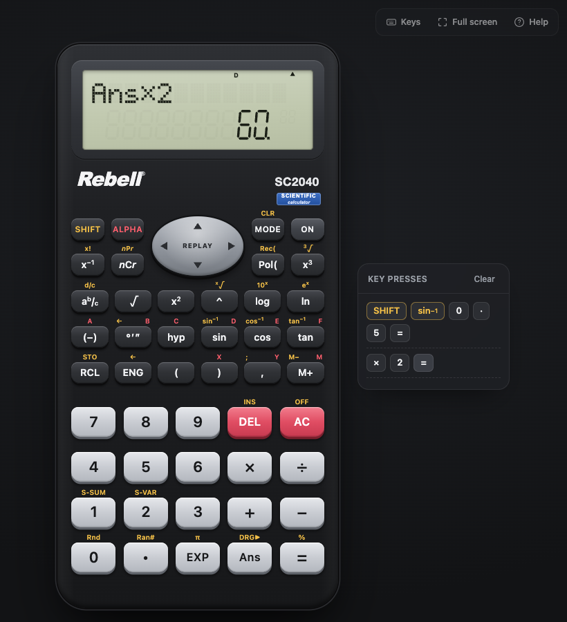

# SC2040 Calculator

A desktop emulator of the **Rebell SC2040** scientific calculator, built for teachers who want to show the calculator to a class on a laptop or projector.

It looks like the real calculator and works like it: the same keys, the same two-line display, and the same modes.



## Download

Get the latest version from the **[Releases page](https://github.com/RealKevinApetrei/sc2040-calculator/releases/latest)**.

| Computer | File | Notes |
|---|---|---|
| Windows (install) | `SC2040-Calculator-…-Setup.exe` | Installs the app and adds a desktop shortcut |
| Windows (no install) | `SC2040-Calculator-…-Portable.exe` | Runs straight from a USB stick or the Downloads folder |
| Mac (Intel or Apple Silicon) | `SC2040-Calculator-…-mac-universal.dmg` | Open it and drag the app to Applications |

**No install allowed on the school laptop?** Use the browser version: **<https://realkevinapetrei.github.io/sc2040-calculator/>**

### First launch

The app is free and not signed with a paid Apple or Microsoft certificate, so each system asks once before it opens:

- **Windows:** if you see "Windows protected your PC", click **More info**, then **Run anyway**.
- **Mac:** right-click (or Control-click) the app, choose **Open**, then click **Open** again. If macOS says the app "is damaged", open Terminal and run:
  ```
  xattr -dr com.apple.quarantine "/Applications/SC2040 Calculator.app"
  ```

## Presenting to a class

- **Key presses panel** (on the right): every key you press shows up there, with SHIFT and ALPHA functions coloured, so students can copy along on their own calculators. Use **Keys** in the top-right corner to hide or show it, and **Clear** to empty it.
- **Full screen:** click **Full screen** in the top-right corner (or press F11 on Windows, Ctrl+Cmd+F on Mac). The calculator grows to fill the screen.
- **Help:** click **Help** (or press `?`) for a quick guide and keyboard shortcuts.
- Memory, modes, statistics data and recent calculations are kept when the app is closed, just like the real calculator.

## What it does

- Two-line display: the calculation on top (dot-matrix), the answer below (10 digits plus a 2-digit exponent)
- **COMP** mode: + − × ÷, brackets, implied multiplication, x², x³, x⁻¹, √, ³√, ˣ√, ^, log, ln, 10ˣ, eˣ, sin/cos/tan and their inverses, hyperbolic functions, x!, nPr, nCr, π, Ran#, Rnd, %, EXP
- **Fractions** (a b/c and d/c), with switching between fraction and decimal answers
- **Degrees-minutes-seconds** (°′″) input and display
- **Angle units:** Deg, Rad, Gra, and DRG▶ conversion
- **Display formats:** Norm 1/2, Fix 0–9, Sci 0–9, ENG and ←ENG
- **Polar and rectangular coordinates** (Pol, Rec), results stored in E and F
- **Memory:** variables A–F, X, Y, M, with STO, RCL, M+, M− and Ans
- **REPLAY:** step back through earlier calculations and edit them, jump to the position of an error
- **SD statistics:** data with frequencies, n, Σx, Σx², mean, population and sample standard deviation, browse and edit data
- **REG regression:** Lin, Log, Exp, Pwr, Inv, Quad, with A, B, C, r, x̂ and ŷ
- Error messages (Syntax ERROR, Math ERROR, Stack ERROR) behave like the real calculator
- CLR (memory, mode, all), insert/overwrite editing, ON/OFF

## Keyboard shortcuts

| Key | Calculator key | Key | Calculator key |
|---|---|---|---|
| 0–9 `.` `+` `-` `*` `/` `^` `(` `)` | as labelled | Enter | = |
| Backspace | DEL | Esc | AC |
| Arrow keys | REPLAY | tap Shift | SHIFT |
| tap Alt/Option | ALPHA | `s` `c` `t` | sin cos tan |
| `h` | hyp | `l` `n` | log ln |
| `r` `q` | √ x² | `f` | a b/c |
| `d` | °′″ | `p` | π |
| `!` | x! | `%` | % |
| `e` | EXP | `a` | Ans |
| `m` | M+ | `o` | MODE |

## For developers

```
npm install
npm start            # run the app
npm test             # engine and key-sequence tests
npm run dist:mac     # build the Mac .dmg and .zip into dist/
npm run dist:win     # build the Windows Setup and Portable .exe into dist/
```

The calculator itself is plain HTML, CSS and JavaScript in [`app/`](app/), with no dependencies. Electron only wraps it as a desktop app.

- `app/engine.js`: parser, maths, fractions, number formatting, statistics
- `app/calc.js`: key handling, modes, menus, memory, replay
- `app/lcd.js`, `app/font5x7.js`: the LCD display
- `app/ui.js`, `app/style.css`: the keypad and the window

## Disclaimer

This is an unofficial classroom tool. It is not made, endorsed or supported by Rebell. "Rebell" and "SC2040" are used only to describe which calculator this app emulates.

## Licence

MIT
